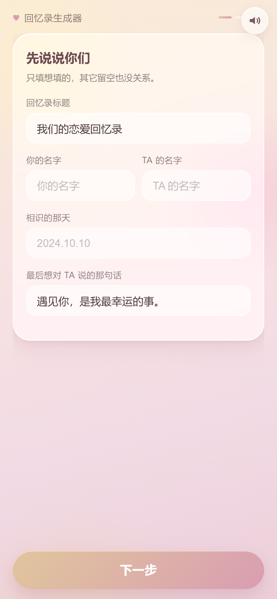
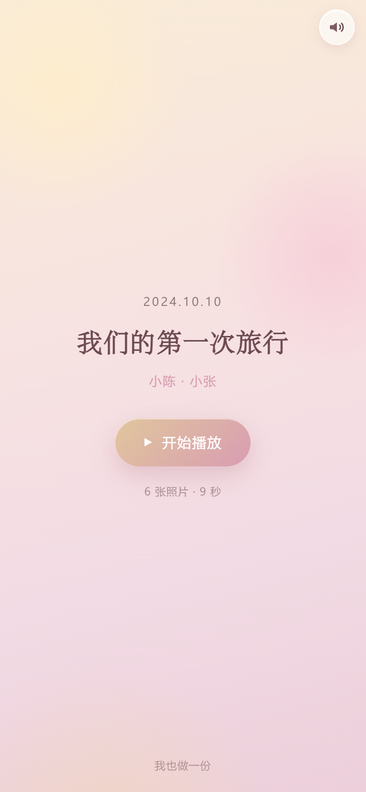
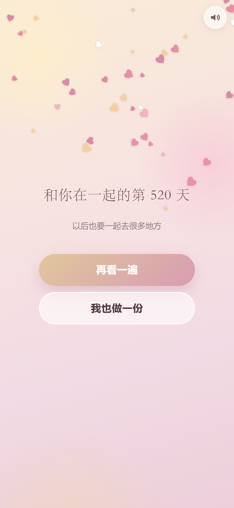
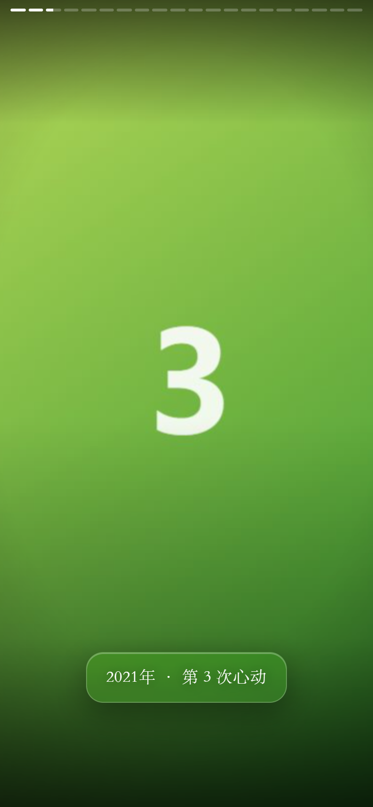

# 我们的恋爱回忆录

[](https://github.com/yuanshen-123-ui/love-memoir/actions/workflows/ci.yml)
[](LICENSE)

> 一份能「自己生成」的 H5 恋爱回忆录。
> 访客进来填内容、传 20 张照片 → 得到一个专属链接；打开链接的人看到的是全屏卡点短片 + 撒花。
> 另外保留了最早那封「只能给她看」的固定版（`/letter`：点亮一颗心 → 刮开回忆 → 默契挑战 → 星空贴贴）。
> 部署在 <https://love.ccflysim.cn>，90% 以上的访问来自手机、大概率在微信里打开，所以**整套设计只照顾手机**。

## 现在它长这样

**首页 = 创作页**（任何人都能做一份自己的），**/a/xxx = 播放页**（别人点开链接看到的）：

| 创作 · 填内容传照片 | 播放页封面 | 播放完的撒花 |
| :---: | :---: | :---: |
|  |  |  |

**/letter = 最早那封固定版**（保留原样，没删）：

| 开场 · 放进第一张照片 | 第一关 · 点亮成一颗心 |
| :---: | :---: |
|  |  |

| 通关 · 分享海报 | 结局 · 星空与爱心雨 |
| :---: | :---: |
|  |  |

截图都是真机尺寸模拟（390×844 @2x）下跑出来的，不是设计稿。

---

## 0. 三条路由 + 两套后端

| 路由 | 是什么 | 数据从哪来 |
| --- | --- | --- |
| `/` | **创作页**：分三步填内容（你们 → 照片+字幕 → 确认），生成分享链接 | 用户当场填，上传到后端 |
| `/a/:album_id` | **播放页**：封面 → 20 张照片卡点播放 → 撒花 + 结尾那句话 | `GET /api/album/{id}` |
| `/letter` | 最早那封固定版（文案在 `src/config.js`，照片只存在本机 localStorage） | 纯前端，不联网 |

后端 `backend/`（FastAPI + SQLite + 本地图片）：

| 接口 | 干什么 |
| --- | --- |
| `POST /api/upload` | multipart：`payload`(JSON 文案) + `photos`(1~20 张)。存图 → 洗 EXIF → 落库 → 返回 `album_id` 和 `share_url` |
| `GET /api/album/{id}` | 返回完整配置 + 照片 URL 列表，前端拿去播放 |
| `GET /api/health` | 健康检查（`{"ok":true,"albums":N,"views":M}`） |
| `GET /api/docs` | FastAPI 自动生成的接口文档（自己调试用） |
| `/static/uploads/…` | 上传的照片。生产环境由 **nginx 直接读盘**，不经过 Python |

数据落在哪儿：

```
/opt/love-memoir-api/
├── data/albums.db              SQLite：id / payload(JSON) / photos(JSON) / created_at / views
└── static/uploads/<album_id>/  <uuid>.jpg   每张图服务端二次压缩，长边 1600、JPEG 82
```

**隐私与防滥用（都是真跑过验证的）**：
- 手机原图的 **EXIF/GPS 全部洗掉** —— 重画到干净画布再存，一个字节都不留
- `album_id` 用 `secrets` 生成 12 位随机串，猜不到别人的回忆录
- 单 IP 每小时最多 20 次上传；单张 ≤8MB、单次 ≤80MB（nginx 层 96MB）
- 服务端二次压缩：前端压缩可被绕过（直接打接口），必须后端兜底

---


## 1. 它有什么

### 体验

- **开场**：液态玻璃相框悬浮在香槟金→冷玫瑰的渐变里，点一下唤起相册，照片以弹簧动效落进框里
- **第一关 · 初识心动**：13 颗星**落在一条心形曲线上**（不是随机撒的），逐颗点亮，音高顺着五声音阶往上走；全部点亮后，一笔把整颗心描出来
- **第二关 · 专属记忆**：Canvas 刮刮乐，手指划开雾面露出照片，刮开后照片极缓慢地推近（Ken Burns）
- **第三关 · 默契挑战**：答错整张卡片弹性抖动，答对三音上行
- **通关**：85vw 玻璃明信片，弹簧上浮；还能**一键生成一张 750×1200 的分享海报**（长按存进相册）
- **结局**：背景转入星空，打字机打出「遇见你，是我最幸运的事。」，「贴贴」触发 44 颗纯 CSS 爱心
- **八音盒背景音乐 + 音效**：全部用 WebAudio **现场合成**，没有 mp3，仓库里一个音频文件都没有
- **两个彩蛋**：连点「贴贴」10 次；长按结局那句话 1.5 秒

### 移动端（这是重点）

| 要求 | 实现 |
| --- | --- |
| 防微信上下拖拽 | `overscroll-behavior-y: none` + `touch-action: pan-y` + `overflow: hidden`，每屏绝对定位，页面本身永不滚动 |
| iPhone 小黑条 | 所有底部按钮在 `.thumb-bar` 里，统一 `env(safe-area-inset-bottom)`；viewport 带 `viewport-fit=cover` |
| 100vh 吃高度 | 三级兜底：`100vh` → `100dvh` → JS 实测 `--app-h`（iOS 15 / 微信 X5 走第三条） |
| 零原生组件 | 文件框移出屏幕、滚动条全隐藏、`alert` 换成自绘玻璃 toast |
| 没有 hover | 全站零 `:hover`，只有 `:active { transform: scale(0.96) }` |
| 毛玻璃别卡 | `backdrop-filter` **锁死 12px**，且同一屏只叠必要的层；老内核（Chromium <76）有 `@supports not` 退化 |
| 横屏 | 直接盖一层「把手机竖过来吧」的提示，不做一套收益极低的横屏布局 |
| 弱网 | 整站 ~120KB（gzip 46KB），零外部请求（CSP 只放行 `'self'`） |

### 工程

- **32 个单元测试**（Vitest）：心形曲线的数学性质、随机数可复现性、图片目标尺寸、config 自检
- **ESLint 9 flat config + CI 硬约束**：禁止原生弹窗、禁止 `:hover`、`100vh` 只许出现在三级兜底里
- **一键部署**：`deploy/deploy.ps1`（构建→打包→上传→远端解包→17 项自动冒烟）
- **17 项线上冒烟**：`deploy/smoke.ps1`，用 PNG magic bytes 校验图标（避免被 SPA 兜底的 200 假绿）
- **换掉故事只用改一个文件**：`src/config.js`，改错了开发态会在控制台中文提示，CI 也会拦住

---

## 2. 快速开始

```bash
npm install
npm run dev        # http://localhost:5174（已开 host，手机连同一局域网可直接访问内网 IP）
npm run build      # 产物在 dist/
npm run preview    # 预览构建产物，http://127.0.0.1:4174

npm run lint       # ESLint
npm test           # 单元测试（Vitest）
npm run check      # lint + test + build 一条龙
npm run gen:icons  # 重新生成图标与 og.png（纯 Node，无图形库）
npm run dev:montage # 单独预览「20 张照片伪视频」组件（dev/montage-harness.html）
```

前端要能创建回忆录，还得把后端跑起来（Python 3.10+）：

```bash
cd backend
python -m venv .venv
.venv/Scripts/pip install -r requirements.txt -r requirements-dev.txt   # Windows
# .venv/bin/pip install ...                                            # macOS / Linux
.venv/Scripts/python -m pytest        # 18 个接口测试
cd .. && npm run api                  # uvicorn 跑在 127.0.0.1:8010
```

`npm run dev`（5174）已经把 `/api` 和 `/static` 代理到 8010，所以本地前后端一起跑就行。

---

## 3. 目录结构

```
src/
├── main.js                     # 挂载入口 + 路由表（/ 、/a/:id 、/letter）
├── App.vue                     # 外壳：声音开关、提示层、错误兜底、RouterView
├── config.js                   # ★ /letter 那封固定版的全部文案 / 题目 / 答案
├── style.css                   # 设计系统：变量、玻璃、按钮、关键帧、胶片颗粒
├── api/
│   └── client.js               # ★ 调后端：createAlbum（带上传进度）/ getAlbum
├── views/
│   ├── CreateView.vue          # ★ 首页：三步创作（你们 → 照片+字幕 → 生成链接）
│   ├── AlbumView.vue           # ★ /a/:id：封面 → 蒙太奇播放 → 撒花
│   └── LetterView.vue          # /letter：最早那封固定版（四关小游戏）
├── audio/
│   └── sound.js                # ★ 零素材音频引擎（八音盒 BGM + 音效，WebAudio 合成）
├── composables/
│   ├── useViewport.js          # 真实高度 → --app-h（治 100vh）
│   ├── useTypewriter.js        # 打字机（逐字 + 标点停顿 + 尊重减少动效）
│   └── useToast.js             # 自定义提示（代替原生 alert）
├── utils/
│   ├── image.js                # ★ Canvas 压缩 + EXIF 转正 + fitSize
│   ├── poster.js               # ★ Canvas 合成 750×1200 分享海报
│   ├── heart.js                # ★ 心形曲线（等弧长采样 13 点 + SVG 路径）
│   ├── storage.js              # localStorage（照片 / 进度 / 声音偏好，含配额与无痕降级）
│   ├── random.js               # 可复现 LCG 随机数
│   ├── validateConfig.js       # config.js 自检
│   └── misc.js                 # 震动、clamp
└── components/
    ├── UploadFrame.vue         # 一、开场：玻璃相框 + 隐藏 file input + 弹簧落图
    ├── StarLevel.vue           # 二、第一关：心形 13 星 → 描出一颗心
    ├── ScratchLevel.vue        # 二、第二关：Canvas 刮刮乐
    ├── QuizLevel.vue           # 二、第三关：默契挑战
    ├── PostcardModal.vue       # 三、通关明信片
    ├── PosterModal.vue         # 三、分享海报弹层
    ├── EndingScene.vue         # 四、结局：星空 + 打字机 + 贴贴 + 彩蛋
    ├── HeartRain.vue           # 四、撒花：纯 CSS 爱心雨
    ├── SoundToggle.vue         # 右上角声音开关
    ├── RotateTip.vue           # 横屏提示
    ├── MontagePlayer.vue       # ★ 20 张照片的「伪视频」播放器（双层 DOM + Ken Burns 运镜）
    ├── GlassButton.vue         # 按钮
    └── ToastHost.vue           # 提示层

tests/                          # 32 个 Vitest 单元测试（前端纯函数）
dev/montage-harness.html(.js)   # MontagePlayer 的独立预览页（只在 dev 下用，不进构建产物）
scripts/gen-icons.mjs           # 纯 Node 生成 PNG（自己写的 PNG 编码器）
backend/                        # ★ FastAPI 后端
├── app/
│   ├── main.py                 # 接口：/api/upload、/api/album/{id}、/api/health
│   ├── models.py               # Pydantic 模型（上传校验 / 返回结构）
│   ├── images.py               # 图片校验 → 转正 → 压缩 → 洗 EXIF → 落盘
│   ├── db.py                   # 标准库 sqlite3，单表 + 一把锁
│   ├── ids.py                  # album_id 生成（secrets，12 位随机）
│   └── config.py               # 全部从环境变量读
├── tests/test_api.py           # 18 个接口测试
├── deploy/                     # systemd unit、nginx 补丁、部署/核验脚本
├── static/uploads/             # 上传的图片（gitignore）
└── data/                       # SQLite（gitignore）
deploy/
├── deploy.ps1                  # 一键部署前端
├── smoke.ps1                   # 线上冒烟（19 项）
└── remote-extract.sh           # 服务器端解包
nginx/
├── love.ccflysim.cn.conf            # 正式配置（80→443 + SPA 防 404 + /api 反代 + 缓存策略）
└── love.ccflysim.cn.http-first.conf # 首次签发证书时用的临时配置
```

---

## 4. 改成你们自己的故事

只改 `src/config.js`：

| 字段 | 作用 |
| --- | --- |
| `title` / `subtitle` | 开场标题、纪念日 |
| `upload.*` | 相框提示语与按钮文案 |
| `star.*` | 第一关标题与提示 |
| `scratch.*` | 第二关提示语、刮开后的小字（`caption`） |
| `quiz.questions[]` | **题目与答案**：`ok: true` 的那一项才是正确答案 |
| `quiz.wrong[]` | 答错时随机弹的一句 |
| `postcard.*` | 明信片正文（`lines` 是数组，一行一句）、落款、日期 |
| `poster.*` | 分享海报上的标题 / 那句话 / 日期 / 页脚 |
| `ending.line` | 结局打字机那句话 |
| `ending.secret` | 长按才看得到的彩蛋句 |
| `ending.after` | 贴贴之后浮现的那句 |
| `ui.hugEggAt` / `ui.hugEggLine` | 连点彩蛋的触发次数与吐槽 |

配色在 `src/style.css` 顶部的 `:root`：改 `--c-gold*` / `--c-rose*` 两组变量即可整套换肤。

> 改错了不用怕：`npm run dev` 时控制台会用中文列出来哪一项不对；
> `npm test` 也会因为「config 自检」而失败，CI 直接红。

---

## 5. 几个值得说的实现

### 5.1 液态玻璃：为什么死死锁在 `blur(12px)`

`backdrop-filter` 是**逐帧重新计算背景模糊**，代价与被模糊像素数成正比。安卓 X5 内核上 `blur(20px)` 叠两层就能让滑动掉到 30fps 以下。所以配方固定：

```css
background: rgba(255, 255, 255, 0.6);
backdrop-filter: blur(12px) saturate(180%);
box-shadow: 0 10px 30px rgba(170,110,130,.16),
            inset 0 1px 0 rgba(255,255,255,.92),    /* 上高光 */
            inset 0 -1px 0 rgba(255,255,255,.3),    /* 下反光 */
            inset 0 0 0 .5px rgba(255,255,255,.45); /* 描边感 */
```

「高级感」靠三层 `inset` 内阴影堆出来，而不是靠更大的模糊值。明信片弹层的遮罩**故意不加 blur** —— 底下已经是一片玻璃了。

### 5.2 第一关：13 颗星落在一条心形曲线上

经典心形参数方程：

```
x(t) = 16·sin³t
y(t) = 13·cos t − 5·cos 2t − 2·cos 3t − cos 4t
```

直接按 `t` 均匀取点会挤在心尖，所以先在曲线上密采 480 点算**累计弧长**，再按等弧长挑 13 个位置（`utils/heart.js`）。
归一化到 `[0,1]²` 并翻转 y 轴后，组件里直接用百分比定位；星域容器是**正方形**，否则心会被拉扁。

全部点亮后，同一套归一化坐标生成 SVG path（96 段），用 `stroke-dashoffset` 从满值动画到 0 —— 一笔画出整颗心。

### 5.3 音乐：为什么一个音频文件都没有

八音盒音色本质就是「正弦波 + 快起音 + 慢指数衰减 + 一点延迟」。所以整站没有 mp3：

- 音阶用 C 大调五声音阶（去掉半音，随机游走怎么走都不难听）
- 用一个 250ms 的定时器 + 0.8s 前瞻往音频线程排音符（WebAudio 标准做法，主线程卡一下也不跑调）
- iOS/微信必须**在用户手势里**创建/恢复 `AudioContext`：`App.vue` 在第一次 `pointerdown` 上调 `unlock()`
- 切到后台自动暂停并 `suspend()`，回来再续（省电，也避免时间戳跳变导致音符堆叠）
- 结局把速度调慢、留白变多（`mood = 'ending'`）

### 5.4 分享海报：Canvas 现场画一张卡片

`utils/poster.js` 用 2D 矢量画 750×1200：渐变底 → 玻璃卡片 → 照片 cover 裁剪（不变形）→ 衬线体情话 → 日期 → 页脚。
中文长句按字符逐个 `measureText` 折行（中文没有空格可断）。

微信里保存图片的正规姿势是**长按图片 → 保存到相册**，所以弹层主体就是一张 ``，另配一个 `<a download>` 作兜底。

### 5.5 撒花：为什么不用 Canvas 粒子

40 颗粒子的 Canvas 方案 = 每秒 2400 次 JS 绘制调用，骁龙 6 系老安卓直接掉到 20fps。
这里改成 **44 个 `<span>♥</span>` + 一条 CSS 动画**：只动 `transform`/`opacity`，走合成器，JS 主线程一次都不跑。
`animation-fill-mode: both` 保证延迟期间不可见（否则爱心会先扎堆出现在顶部）；一轮落完父组件卸载 DOM。

### 5.6 进度不丢

照片、进度、声音偏好都进 `localStorage`；刷新后回到上次那一关（但本关重新开始）。
`storage.js` 对「访问 localStorage 就抛异常」的环境（iOS 无痕、被清理过的 WebView）做了内存兜底。

### 5.7 优雅降级

- **系统开启「减少动态效果」**：爱心改成原地淡入淡出、答错抖动改成红色泛光、打字机直接整句显示、装饰循环动画关闭
- **没有 `AudioContext`**：所有音频函数安静地什么都不做
- **`config.js` 某题忘了标 `ok: true`**：把第一个选项当正确答案并警告，绝不让她卡死
- **渲染抛错**：`onErrorCaptured` 兜住，给一张「刷新一下」的卡片，而不是白屏

### 5.8 伪视频播放器：20 张图只占 2 个 ``

`MontagePlayer.vue` 把 20 张照片播成「抖音图文卡点」的样子。三个关键设计：



**① 双层 DOM 交替，绝不让 20 张图同时进 DOM**

800×1200 的 JPEG 解码后约 3.7MB/张，20 张同时挂在 DOM 上就是 70MB+，iOS Safari 很容易直接杀掉进程。
所以只有 A/B 两个 `.slot`，换图 = 改 `src`，元素永不重建：

```
第 1 张：slot0 装 1，opacity 1       slot1 空
第 2 张：slot1 装 2，opacity 0→1     slot0 opacity 1→0   ← 交叉淡化
第 3 张：slot0 装 3，opacity 0→1     slot1 opacity 1→0
…
```

**② 换图前先解码，再淡入**

直接改 `src` 就淡入的话，iOS 上大图解码会阻塞主线程，淡入那一瞬正好在解码 → 掉帧 + 闪黑。
所以先 `new Image()` + `decode()` 把下一张准备好（还会顺手预取下一张），再开始交叉淡化。
另外 `slot.visible = true` 之前要 `await` 两帧 —— 等「opacity: 0」真的画上去，`transition` 才有起点。

**③ 运镜靠换 `animation-name` 重启动画**

不重建节点，只切 `kb-zoom / kb-pan-l / kb-pan-r / kb-rise / kb-tilt-l / kb-tilt-r` 六个动画名。
CSS 动画会因为动画名变了自动从头播；六套轮转、两个槽交替，同一槽位连续两次拿到的名字必然不同 → 一定重启。
全部只改 `transform`，配合 `will-change: transform` 交给 GPU。

其余细节：运镜时长 = 停留 + 淡化（交叉那 600ms 画面还在继续推，不会「停下来」）；
歌词用衬线体 + `backdrop-filter: blur(14px)` 玻璃条，切歌时换 `cap-rise-1/2/3` 重新上浮；
顶部是 20 段抖音式进度（用 `scaleX` 不用 `width`）；
控制条默认隐藏，点一下屏幕浮出 3 秒；切后台自动暂停；卸载时把 `src` 清空主动释放位图。

```vue
<MontagePlayer
  :photos="base64List"   <!-- 20 张 base64 或 URL -->
  :lines="captions"      <!-- 和照片一一对应的字幕 -->
  :slot-ms="1500"
  tone="site"            <!-- 默认 site：透明，露出宿主页面同一个底色；dark = 纯黑电影感 -->
  @ended="() => (showHearts = true)"
/>
```

> 默认 `tone="site"` 是刻意的：这块是全屏的，如果固定纯黑，播放时整站底色会突然变成另一块颜色。
> 照片本身是 `object-fit: cover` 铺满的，底色只在交叉淡化那 600ms 里露出来。

### 5.9 底色只有一个来源

踩过一次很典型的坑：

`index.html` 内联了一个渐变（想给首屏用），`style.css` 的 `body` 又写了个纯色 `#f6e3dc`。
而 Vite 会把 style.css 打包成 `<link>` 插在 `<head>` **末尾** —— 它排在 `<style>` 后面，
于是**内联那个渐变根本没生效**，被纯色覆盖了。
结果就是：打开页面先看到一块纯色，JS 挂载后才变成渐变，底色肉眼可见地跳了一下。

现在规则只有一条：**底色只在 `index.html` 的 `:root` 里定义一次**（`--bg-grad` / `--bg-fill`）。

- `html` 负责画渐变（首屏第一帧就有底色，不白闪）
- `body` 必须 `background: transparent`，否则会盖住 html 那层
- `style.css` 的 `.bg-base`、`RotateTip` 都只 `var(--bg-grad)`，不写色值
- `theme-color` 与 manifest 的 `theme_color` / `background_color` 都等于 `--bg-fill`

`tests/background.test.js` 守住这条（连「全仓库只有 `index.html` 一处出现那个渐变色值」都断言了），以后再有人手抖写第二个色值 / 给 body 加背景，CI 直接红。

---

## 6. 测试与 CI

```bash
npm run lint   # ESLint 9（flat config，只开 essential）
npm test       # 32 个单测
npm run check  # 上面两个 + build
```

单测测的是「能算错的地方」，不是覆盖率数字：

| 文件 | 测什么 |
| --- | --- |
| `tests/heart.test.js` | 13 个点都在 `[0,1]`、心尖在下、两瓣对称、**除心尖折角外相邻弦长一致**（证明是弧长等分而非 t 等分） |
| `tests/random.test.js` | 同种子同序列、值域、10 桶分布均匀 |
| `tests/image.test.js` | 横图/竖图/全景/小图不放大/异常输入不出 0 |
| `tests/config.test.js` | 仓库里的 config 必须通过自检；每道题恰好一个 `ok: true`；故意改坏的 6 种情况都能报出来 |
| `tests/background.test.js` | **底色单一来源**：body 必须透明、`style.css` 不得重复定义 `--bg-grad`、全仓库只有 `index.html` 出现那个渐变色值、`theme-color` / manifest 与 `--bg-fill` 对齐（这个测试是为了防止「首屏一个色、挂载后另一个色」的闪变复发） |

CI（GitHub Actions）在 push/PR 上跑：`npm ci → lint → test → build → 产物体积 → 静态检查`。
静态检查是三条硬红线：**禁止原生 `alert/confirm/prompt`**、**禁止 `:hover`**、**`100vh` 只许出现在 `.style` 的三级兜底里**。

---

## 7. 部署

### 7.1 一键部署（推荐）

```powershell
.\deploy\deploy.ps1              # 前端：构建 → 打包 → 上传 → 解包 → 19 项冒烟
.\backend\deploy\deploy-backend.ps1   # 后端：打包 → 上传 → venv/依赖/systemd/nginx 反代/自检
```

纯静态站换完文件立即生效，**不需要 reload nginx**（`assets` 文件名带内容哈希，`index.html` 是 `no-store`）；
后端那步会自己 `systemctl restart` + `nginx -t` + `reload`。

后端第一次安装会从 PyPI 拉 ~20 个包，**国内机器建议等 10 分钟**（这台机器到官方源只有十来 KB/s，
`install.sh` 里默认已经换成阿里云镜像）。装完之后 `systemctl restart love-memoir-api` 是秒级的。

### 7.2 手动部署

```bash
npm run build
scp -r dist/* root@YOUR_SERVER_IP:/var/www/love.ccflysim.cn/
```

### 7.3 线上现状（2026-10-17 部署，v2）

| 项 | 值 |
| --- | --- |
| 访问地址 | <https://love.ccflysim.cn> |
| 服务器 | `YOUR_SERVER_IP` · Ubuntu · **nginx 1.18.0** |
| 站点根目录 | `/var/www/love.ccflysim.cn` |
| nginx 配置 | `/etc/nginx/sites-available/love.ccflysim.cn`（软链进 sites-enabled） |
| 证书 | Let's Encrypt，`CN=love.ccflysim.cn`，到期 **2027-01-15** |
| 自动续期 | `certbot.timer`（每日）+ `renew_hook = systemctl reload nginx` |
| HTTP/2 | 已开启（`listen 443 ssl http2`，1.18 的写法） |
| 缓存 | `assets/*` → `public, max-age=31536000, immutable`；`index.html` → `no-store` |
| SPA 防 404 | `try_files $uri $uri/ /index.html`（`/whatever/123` 返回 200） |
| 防护 | CSP（放行 `img-src data:`）、`X-Content-Type-Options`、`X-Frame-Options`、`Referrer-Policy`、`Permissions-Policy` |
| 后端 | FastAPI + uvicorn 只监听 `127.0.0.1:8010`，systemd 单元 `love-memoir-api`（`active`） |
| 后端数据 | `/opt/love-memoir-api/data/albums.db`（SQLite WAL）；图片 `/opt/love-memoir-api/static/uploads/<album_id>/` |
| 反代 | `location /api/` → 8010（`client_max_body_size 96m`，读超时 120s）；`location /static/uploads/` 由 nginx **直接 alias 读盘**（不走 Python），`cache-control: public, max-age=2592000` |

**首次部署顺序**（顺序反了 `nginx -t` 会因为证书不存在而失败）：

```bash
# 1) 上传 dist
ssh root@YOUR_SERVER_IP 'mkdir -p /var/www/love.ccflysim.cn'
scp -r dist/* root@YOUR_SERVER_IP:/var/www/love.ccflysim.cn/

# 2) 先用「仅 HTTP」的临时配置把域名跑起来
scp nginx/love.ccflysim.cn.http-first.conf root@YOUR_SERVER_IP:/etc/nginx/sites-available/love.ccflysim.cn
ssh root@YOUR_SERVER_IP 'ln -sf /etc/nginx/sites-available/love.ccflysim.cn /etc/nginx/sites-enabled/love.ccflysim.cn && nginx -t && systemctl reload nginx'

# 3) 申请证书
ssh root@YOUR_SERVER_IP 'certbot certonly --webroot -w /var/www/love.ccflysim.cn -d love.ccflysim.cn --non-interactive --agree-tos'

# 4) 换成正式配置（80 跳 443 + 安全头 + 缓存）
scp nginx/love.ccflysim.cn.conf root@YOUR_SERVER_IP:/etc/nginx/sites-available/love.ccflysim.cn
ssh root@YOUR_SERVER_IP 'nginx -t && systemctl reload nginx'
```

### 7.4 续期（踩过的坑）

```bash
certbot renew --cert-name love.ccflysim.cn --dry-run   # ← 会先睡 0~8 分钟随机延迟！
# 日志里是 "Non-interactive renewal: random delay of 99.17 seconds"，
# 看着像卡死，其实是在做防雪崩的随机抖动。别用 100 秒超时去掐它。
```

想快速确认续期链路健康，用这个（跳过随机延迟，完整跑一次 HTTP-01）：

```bash
certbot certonly --webroot -w /var/www/love.ccflysim.cn -d love.ccflysim.cn \
  --cert-name love.ccflysim.cn --dry-run --non-interactive
# → The dry run was successful.
```

---

## 8. 调试

浏览器控制台里有个后门（`App.vue` 里注册）：

```js
__loveMemoir__.goto('level1')   // 直接跳关：level1 / level2 / level3 / ending
__loveMemoir__.getState()       // 当前状态
__loveMemoir__.getPhoto()       // 有没有照片
__loveMemoir__.restart()        // 清空照片与进度，回到开场
```

验收时值得量的几个值：

```js
document.querySelector('.stage').getBoundingClientRect().height  // 应该 == window.innerHeight
document.documentElement.scrollWidth <= window.innerWidth         // 不能横向溢出
getComputedStyle(document.body).overscrollBehaviorY               // 'none'
localStorage.getItem('love-memoir:photo').length                  // 压缩后应 < 1.3MB
document.querySelectorAll('.star').length                         // 13
```

两个彩蛋，别写进给她的提示里：

- 结局里连点「贴贴」10 次
- 长按「遇见你，是我最幸运的事。」1.5 秒

---

## 9. 已知限制（都是平台限制，不是 bug）

### 平台相关

1. **微信里点「选照片」一定会弹出系统相册/相机选择器** —— 任何网页都绕不过（`<input type=file>` 是唯一入口），但它本身是原生体验，不难看。
2. **iOS 没有震动**：`navigator.vibrate` 在 iOS Safari 里不存在，只在安卓生效（已静默降级）。
3. **微信里长按保存图片对 dataURL 的支持因版本而异**：所以海报弹层给了「长按」+「下载图片」+「截屏」三条路。
4. **HEIC**：iOS 用 `<input type=file>` 选照片时系统会自动转 JPEG；但在电脑上直接拖 HEIC 会解码失败并提示换一张。
5. **localStorage 约 5MB**：`/letter` 那封固定版只存一张压缩照，够用；配额不足时 toast 提示，本次会话仍能玩完。
6. **无痕/隐私模式**：部分环境 `localStorage` 不可写，会降级为内存存储（刷新后要重选照片）。

### 这个生成器本身的取舍

7. **没有用户账号，也没法「编辑/删除」自己的回忆录**：拿到链接的人就能看，知道 `album_id` 才能删（目前只能人工上服务器删）。
8. **任何人都能创建**（只有一个很朴素的单 IP 限流）：公网放开就意味着会有人乱传，真要长期开放得加验证码/审核。
9. **单机 SQLite + 本地磁盘**：这是刻意的轻量选择，适合「几十到几千份回忆录」的量级；要上量就换 Postgres + OSS，接口不用改（`db.py` / `images.py` 各换一处）。
10. **上传的照片会一直留在服务器上**：没有过期清理任务，需要的话加个 cron 删 90 天前的即可。
11. **`/letter` 和生成器是两套数据**：固定版永远不联网（照片只在她手机上），生成器才走后端。

---

## 10. License

- **代码**：[MIT](LICENSE) —— 随便用、随便改、随便拿去写你自己的版本。
- `src/config.js` 里那套示例文案也一起开源，你改成自己的就行。
- 但**你自己的照片、你们的故事、线上服务器的证书私钥**不在这个仓库里，也不在开源范围内。
  照片只存在访问者自己手机的 `localStorage` 里，**从不上传任何服务器** —— 这一点是刻意的。
