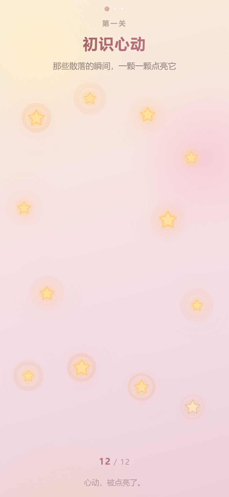
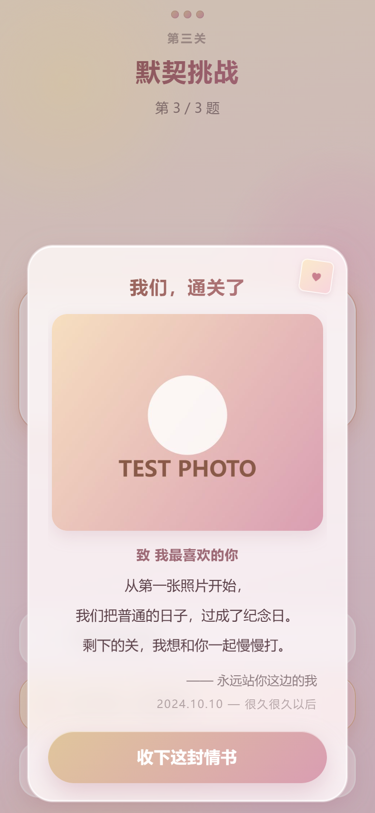

# 我们的恋爱回忆录

[](https://github.com/yuanshen-123-ui/love-memoir/actions/workflows/ci.yml)
[](LICENSE)

> 一个只给一个人看的 H5 小游戏。四步：放进第一张照片 → 点亮星星 → 刮开回忆 → 默契挑战 → 星空和贴贴。
> 部署在 <https://love.ccflysim.cn>，90% 以上的访问来自手机 / 微信内置浏览器，所以**整套设计只照顾手机**。

## 界面预览

截图是真机尺寸模拟（390×844 @2x）下跑出来的，不是设计稿：

| 开场 | 第一关 · 点亮星星 |
| :---: | :---: |
|  |  |

| 通关明信片 | 结局 · 星空与爱心雨 |
| :---: | :---: |
|  |  |


---

## 1. 技术栈

| 项目 | 选择 | 原因 |
| --- | --- | --- |
| 框架 | Vue 3（`<script setup>`） | 状态机 + 组件化，单文件就能跑起来 |
| 构建 | Vite 5 | 产物 ~100KB JS（gzip 39KB），无第三方 UI 库 |
| 样式 | 原生 CSS（scoped） | 不引入 Tailwind/AntD，少一层解析、少几十 KB |
| 状态 | 纯 `ref` / 状态机 | 没有 Vuex/Pinia，这个体量用不上 |
| 图片 | Canvas API | 相册原图 → 长边 800px JPEG，塞进 localStorage |
| 撒花 | 纯 CSS 动画 | 40 颗爱心走 GPU 合成，不用 Canvas 粒子（详见 §5） |

**零运行时依赖**：`dependencies` 里只有 `vue`，`node_modules` 一共 31 个包。

---

## 2. 快速开始

```bash
npm install
npm run dev       # http://localhost:5174  （已开 host，手机连同一局域网可直接访问内网 IP）
npm run build     # 产物在 dist/
npm run preview   # 本地预览构建产物，http://127.0.0.1:4174
```

想改「你们的故事」，只改 `src/config.js` 一个文件就够了（见 §4），不用碰组件。

---

## 3. 目录结构

```
src/
├── main.js                     # 挂载入口
├── App.vue                     # 状态机 + 全局背景 + 屏间调度
├── config.js                   # ★ 所有文案 / 题目 / 答案都在这里
├── style.css                   # 设计系统：变量、液态玻璃、按钮、关键帧
├── composables/
│   ├── useViewport.js          # 真实高度 → --app-h（治 100vh 的老毛病）
│   ├── useTypewriter.js        # 打字机
│   └── useToast.js             # 自定义提示（代替原生 alert）
├── utils/
│   ├── image.js                # ★ Canvas 极限压缩 + EXIF 转正
│   ├── storage.js              # localStorage 封装（含配额/无痕降级）
│   └── misc.js                 # 震动、随机、clamp
└── components/
    ├── UploadFrame.vue         # 一、开场：液态玻璃相框 + 放入第一张回忆
    ├── StarLevel.vue           # 二、第一关：点亮星星
    ├── ScratchLevel.vue        # 二、第二关：Canvas 刮刮乐
    ├── QuizLevel.vue           # 二、第三关：默契挑战（答错抖动）
    ├── PostcardModal.vue       # 三、通关明信片
    ├── EndingScene.vue         # 四、结局：星空 + 打字机 + 贴贴
    ├── HeartRain.vue           # 四、撒花：纯 CSS 爱心雨
    ├── GlassButton.vue         # 按钮
    └── ToastHost.vue           # 提示层
nginx/
├── love.ccflysim.cn.conf            # 正式配置（80 跳 443 + SPA 防 404 + 缓存策略）
└── love.ccflysim.cn.http-first.conf # 首次部署、证书还没签发时用的临时配置
```

---

## 4. 改成你们自己的故事

打开 `src/config.js`，按注释改就行：

| 字段 | 作用 |
| --- | --- |
| `title` / `subtitle` | 开场标题、纪念日 |
| `upload.*` | 开场相框的提示语、按钮文案 |
| `star.*` | 第一关标题与提示 |
| `scratch.*` | 第二关提示语、刮开后的小字（`caption`） |
| `quiz.questions[]` | **题目与答案**：`ok: true` 的那一项才是正确答案（每题数量随意） |
| `quiz.wrong[]` | 答错时随机弹出的一句（想多写几句情话也行） |
| `postcard.*` | 明信片正文（`lines` 是数组，一行一句） |
| `ending.line` | 结局打字机那句话 |
| `ending.after` | 贴贴之后浮现的那句 |

配色在 `src/style.css` 顶部的 `:root`，改 `--c-gold*` / `--c-rose*` 两组变量即可整套换肤。

---

## 5. 关键实现与性能取舍

### 5.1 液态玻璃：为什么死死锁在 `blur(12px)`

`backdrop-filter` 是**逐帧重新计算背景模糊**，代价和被模糊区域的像素数成正比。在安卓 X5 内核（微信）上，`blur(20px)` 叠两层就能让滑动掉到 30fps 以下。

所以这里的配方是固定的：

```css
background: rgba(255, 255, 255, 0.6);
backdrop-filter: blur(12px) saturate(180%);
border: 1px solid rgba(255, 255, 255, 0.66);
box-shadow: 0 10px 30px rgba(170,110,130,.16),
            inset 0 1px 0 rgba(255,255,255,.92),   /* 上高光 */
            inset 0 -1px 0 rgba(255,255,255,.3),   /* 下反光 */
            inset 0 0 0 .5px rgba(255,255,255,.45);/* 描边感 */
```

「高级感」靠三层 `inset` 内阴影堆出来，而不是靠更大的模糊值。
另外给不支持 `backdrop-filter` 的老内核（Chromium < 76）准备了 `@supports not (...)` 退化方案：变成 86% 不透明的白玻璃，依旧好看，不会糊成一团。

整个页面**只有一处**模糊层会同时叠很多个（明信片弹窗），那时我故意**不再给遮罩加 blur** —— 背景已经是一片玻璃了，再模糊一层纯属浪费。

### 5.2 没有 hover，只有 `:active`

```css
.btn:active { transform: scale(0.96); }
```

手机上没有 hover。`:hover` 在触屏上只会在松手后残留一个"粘住"的状态，反而像 bug。全站零 `:hover` 规则，可点元素统一 `transition: transform .16s` + `scale(0.96)` 按压反馈。

### 5.3 100vh 的坑

三层兜底，从旧到新：

```css
.stage {
  height: 100vh;                 /* ① 极老浏览器 */
  height: 100dvh;                /* ② iOS 16.4+ / 现代安卓：跟地址栏伸缩 */
  height: var(--app-h, 100dvh);  /* ③ JS 实测像素：iOS 15 & 微信 X5 走这条 */
}
```

`useViewport.js` 用 `visualViewport.height`（比 `innerHeight` 更及时）在 resize / 转屏 / 地址栏伸缩时把真实高度写进 `--app-h`。

### 5.4 图片压缩（`utils/image.js`）

- `createImageBitmap(file, { imageOrientation: 'from-image' })` —— 一行解决 iPhone 竖拍照片躺倒 90° 的 EXIF 问题
- 长边缩到 **800px**，`toDataURL('image/jpeg', 0.8)`
- PNG 透明区域转 JPEG 会变黑 → 先铺一层 `#fffaf7`
- 超预算时逐级降质量（0.7 → 0.62 → 0.55）再降尺寸，保证一定塞得进 localStorage
- 原图 3~8MB → 一般 **80~200KB** Base64

### 5.5 刮刮乐（`ScratchLevel.vue`）

- 底层放 ``（静态，不参与绘制），上层盖一块 canvas 遮罩
- 擦除用 `globalCompositeOperation = 'destination-out'`，笔刷是**径向渐变**（中心不透明→边缘透明），所以擦出来的边是柔的，不是硬圆
- 手指移动是离散采样，快速滑动会得到虚线 → 两点之间按 `BRUSH * 0.32` 的步长插值补章
- `devicePixelRatio` **封顶 2**（3 倍屏多花 2.25 倍像素却看不出差别）
- 进度检测：`getImageData` 是同步回读，很贵 → 节流 200ms 一次 + 每 6 个设备像素采样一个点；刮开 **55%** 算通过
- canvas 上必须 `touch-action: none`，否则手一划整页跟着滚

### 5.6 撒花：为什么不用 Canvas 粒子

40 颗粒子的 Canvas 方案 = 每秒 2400 次 JS 绘制调用，骁龙 6 系老安卓会直接掉到 20fps，还会跟主线程抢时间片。

这里改成 **44 个 `<span>♥</span>` + 一条 CSS 动画**：

- 只动 `transform` / `opacity` → 触发合成器，不重排、不重绘，JS 主线程一次都不用跑
- `will-change: transform, opacity` 提前提升为合成层
- `animation-fill-mode: both` —— 延迟期间保持 0% 状态（否则爱心会先扎堆出现在顶部）
- 每颗的落点/时长/漂移/旋转用固定种子的线性同余随机生成，同一轮刷新结果一致（好调试）
- 一轮落完（约 6 秒）父组件卸载 DOM，不留几十个节点常驻

### 5.7 防回弹 / 安全区 / 零原生组件

| 要求 | 实现 |
| --- | --- |
| 防微信上下拖拽 | `body { overscroll-behavior-y: none; touch-action: pan-y; overflow: hidden }` + 每屏 `position: absolute; inset: 0`，页面本身永远不滚 |
| iPhone 小黑条 | 所有底部按钮在 `.thumb-bar` 里，统一 `padding-bottom: calc(16px + env(safe-area-inset-bottom))`；`index.html` 的 viewport 带 `viewport-fit=cover`（不带这句 `env()` 永远是 0） |
| 零原生滚动条 | `.scroll-y` + `::-webkit-scrollbar { width:0; height:0 }` + `scrollbar-width: none` |
| 零原生文件框 | `<input type="file">` 挪到屏幕外 (`position:fixed; left:-9999px; opacity:0`)，用自绘按钮 `.click()` 触发；**不能用 `display:none`**，部分旧 iOS/微信里会静默失效 |
| 零原生 alert | 全部走 `composables/useToast.js` 的自绘玻璃 toast |
| 防误触放大 | `maximum-scale=1, user-scalable=no` + 按钮 `touch-action: manipulation`（去掉 300ms 双击延迟） |
| 微信长按菜单 | `-webkit-touch-callout: none` + `user-select: none` |

---

## 6. 部署到 love.ccflysim.cn

> 前置：DNS 里 `love.ccflysim.cn` 的 A 记录已经指向 `YOUR_SERVER_IP`（已确认）。
> 服务器：Ubuntu + **nginx 1.18.0**（不支持 `http2 on;` 新语法，配置里用的是 `listen 443 ssl http2`）。

### 6.1 上传构建产物

```bash
# 本地
npm run build
scp -r dist/* root@YOUR_SERVER_IP:/var/www/love.ccflysim.cn/
```

（首次先 `ssh root@YOUR_SERVER_IP 'mkdir -p /var/www/love.ccflysim.cn'`）

### 6.2 先上「仅 HTTP」的临时配置，把域名跑起来

```bash
scp nginx/love.ccflysim.cn.http-first.conf root@YOUR_SERVER_IP:/etc/nginx/sites-available/love.ccflysim.cn
ssh root@YOUR_SERVER_IP '
  ln -sf /etc/nginx/sites-available/love.ccflysim.cn /etc/nginx/sites-enabled/love.ccflysim.cn
  nginx -t && systemctl reload nginx
  curl -sI http://127.0.0.1 -H "Host: love.ccflysim.cn" | head -1
'
```

### 6.3 申请证书

```bash
ssh root@YOUR_SERVER_IP '
  apt-get install -y certbot   # 已装可跳过
  certbot certonly --webroot -w /var/www/love.ccflysim.cn -d love.ccflysim.cn \
    --non-interactive --agree-tos -m <你的邮箱> --deploy-hook "systemctl reload nginx"
'
```

### 6.4 换成正式配置（80 跳 443 + 安全头 + 缓存策略）

```bash
scp nginx/love.ccflysim.cn.conf root@YOUR_SERVER_IP:/etc/nginx/sites-available/love.ccflysim.cn
ssh root@YOUR_SERVER_IP 'nginx -t && systemctl reload nginx'
```

### 6.5 验收

```bash
# 1. 强制 HTTPS
curl -sI http://love.ccflysim.cn | head -1          # 期望 301
# 2. 证书链
curl -sI https://love.ccflysim.cn | head -1         # 期望 200
# 3. SPA 防 404（随手造一个不存在的路径，必须也返回 200 的 index.html）
curl -s -o /dev/null -w '%{http_code}\n' https://love.ccflysim.cn/whatever/123
# 4. 缓存头
curl -sI https://love.ccflysim.cn/ | grep -i cache-control   # no-store
curl -sI https://love.ccflysim.cn/assets/$(ls dist/assets | head -1) | grep -i cache-control  # immutable
```

### 6.6 之后每次更新

```bash
npm run build && scp -r dist/* root@YOUR_SERVER_IP:/var/www/love.ccflysim.cn/
```

- `assets/*` 文件名带内容哈希，一年强缓存，**替换不失效**
- `index.html` 是 `no-store`，**每次都会拉新的** → 不会出现"微信里还是旧版本"的白屏惨案

### 6.7 线上现状（2026-10-17 已部署）

| 项 | 值 |
| --- | --- |
| 访问地址 | <https://love.ccflysim.cn> |
| 服务器 | `YOUR_SERVER_IP` · Ubuntu · **nginx 1.18.0** |
| 站点根目录 | `/var/www/love.ccflysim.cn` |
| nginx 配置 | `/etc/nginx/sites-available/love.ccflysim.cn`（软链进 sites-enabled） |
| 证书 | Let's Encrypt，`CN=love.ccflysim.cn`，到期 **2027-01-15** |
| 自动续期 | `certbot.timer`（systemd 每日跑）+ `renew_hook = systemctl reload nginx` |
| HTTP/2 | 已开启（`listen 443 ssl http2`，1.18 的写法） |
| 缓存 | `assets/*` → `public, max-age=31536000, immutable`；`index.html` → `no-store` |
| SPA 防 404 | `try_files $uri $uri/ /index.html`（实测 `/whatever/123` 返回 200） |
| 防护 | CSP（放行 `img-src data:`）、`X-Content-Type-Options`、`X-Frame-Options`、`Referrer-Policy`、`Permissions-Policy` |

部署后跑过一次**真机尺寸的移动端 E2E**（playwright + Edge，iPhone 14 模拟 + HTTP/2 线上环境）：
上传压缩 → 三关 → 明信片 → 结局撒花，**55/55 全通过**，无 console 错误。
另外线上 JS 产物的 sha256 与本地 `dist/` 完全一致（`b3f0b7b7…`，99094 字节），确认部署的就是仓库构建出的东西。

**续期验证**（踩过一个坑，记下来免得下次慌）：

```bash
certbot renew --cert-name love.ccflysim.cn --dry-run   # ← 会先睡 0~8 分钟随机延迟！
# 日志里是 "Non-interactive renewal: random delay of 99.17 seconds"，
# 看着像卡死，其实是在做「防雪崩」的随机抖动。别用 100 秒超时去掐它。
```

想快速确认续期链路是否健康，用这个（跳过随机延迟，完整跑一次 HTTP-01）：

```bash
certbot certonly --webroot -w /var/www/love.ccflysim.cn -d love.ccflysim.cn \
  --cert-name love.ccflysim.cn --dry-run --non-interactive
# → The dry run was successful.
```

已固化的东西：

- `/var/www/love.ccflysim.cn/.well-known/acme-challenge/` 建成常态目录（0755，公网可访问）
- `/etc/letsencrypt/renewal/love.ccflysim.cn.conf` 里 `renew_hook = systemctl reload nginx`
- 另有全局 hook `/etc/letsencrypt/renewal-hooks/deploy/reload-nginx.sh`，所有证书续期后都会 reload


更新线上只需：

```bash
npm run build
scp -r dist/* root@YOUR_SERVER_IP:/var/www/love.ccflysim.cn/
```

（`assets/` 是覆盖新增，`index.html` 会立即生效——因为它是 `no-store`，用户刷新即拿到新版本。）

---

## 7. 调试

控制台里有个小后门（`App.vue` 里注册）：

```js
__loveMemoir__.goto('level2')   // 直接跳关：level1 / level2 / level3 / ending
__loveMemoir__.getState()       // 当前状态
__loveMemoir__.reset()          // 清掉照片、回到开场
```

验收时特别值得量的几个值：

```js
document.querySelector('.stage').getBoundingClientRect().height  // 应该 == window.innerHeight
document.documentElement.scrollWidth <= window.innerWidth         // 不能横向溢出
getComputedStyle(document.body).overscrollBehaviorY               // 'none'
localStorage.getItem('love-memoir:photo').length                  // 压缩后应 < 1.3MB
```

---

## 8. 已知限制（都是平台限制，不是 bug）

1. **微信里点"选照片"一定会弹出系统相册/相机选择器** —— 任何网页都绕不过（`<input type=file>` 是唯一入口），但它本身是原生体验，不难看。
2. **iOS 没有震动**：`navigator.vibrate` 在 iOS Safari 里不存在，震动只在安卓上生效（`misc.js` 里已静默降级）。
3. **HEIC 照片**：iOS 下用 `<input type=file>` 选照片时系统会自动转成 JPEG 交给我们，所以 iPhone 的 HEIC 不用特殊处理；但如果用户是在电脑上直接拖 HEIC 文件，会解码失败并提示换一张。
4. **localStorage 约 5MB**：压缩后一张 ~150KB，够用；但如果在同一浏览器里存了别的大数据可能配额不足，此时会 toast 提示"换张小一点的"，且照片仍在内存里，本次会话可正常玩完。
5. **无痕/隐私模式**：部分环境 `localStorage` 不可写，会降级为内存存储（刷新后需要重新选照片），已在 `storage.js` 里处理。
6. **截图分享**：没有做「生成海报」，微信内需要用户自己长按/截屏。如果要加，需要再引 canvas 合成 + 二维码，属于另一个量级的需求。

---

## 9. License

- **代码**：[MIT](LICENSE) —— 随便用、随便改、随便拿去写你自己的版本。
- `src/config.js` 里那套示例文案（题目、情话）也一起开源，你改成自己的就行。
- 但**你自己的照片、你们的故事、线上服务器的证书私钥**不在这个仓库里，也不在开源范围内。
  照片只存在访问者自己手机的 `localStorage` 里，从不上传任何服务器 —— 这一点是刻意的。
