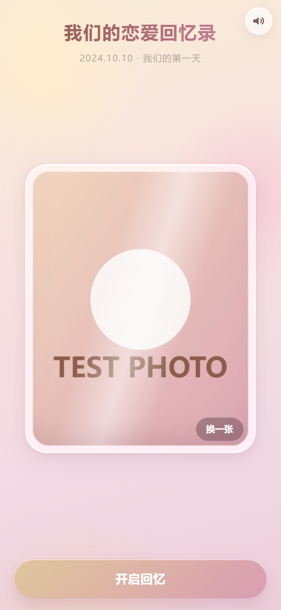
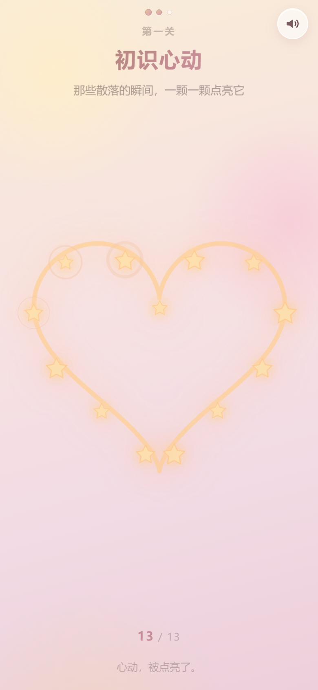
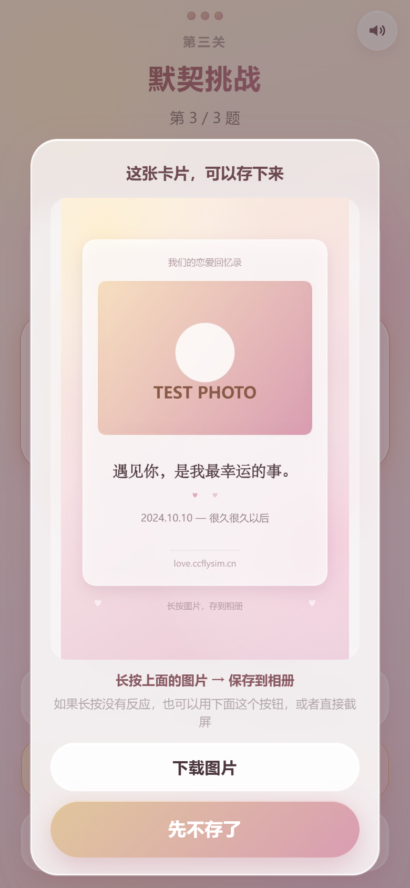
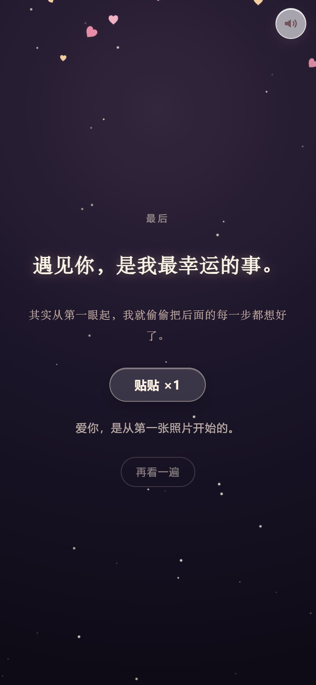

# 我们的恋爱回忆录

[](https://github.com/yuanshen-123-ui/love-memoir/actions/workflows/ci.yml)
[](LICENSE)

> 一个只给一个人看的 H5 小游戏。
> 放进第一张照片 → 点亮一颗心 → 刮开回忆 → 默契挑战 → 星空下贴贴。
> 部署在 <https://love.ccflysim.cn>，90% 以上的访问来自手机、大概率在微信里打开，所以**整套设计只照顾手机**。

## 界面预览

截图是真机尺寸模拟（390×844 @2x）下跑出来的，不是设计稿：

| 开场 · 放进第一张照片 | 第一关 · 点亮成一颗心 |
| :---: | :---: |
|  |  |

| 通关 · 分享海报 | 结局 · 星空与爱心雨 |
| :---: | :---: |
|  |  |

---

## 1. 它有什么

### 体验

- **开场**：液态玻璃相框悬浮在香槟金→冷玫瑰的渐变里，点一下唤起相册，照片以弹簧动效落进框里
- **第一关 · 初识心动**：13 颗星**落在一条心形曲线上**（不是随机撒的），逐颗点亮，音高顺着五声音阶往上走；全部点亮后，一笔把整颗心描出来
- **第二关 · 专属记忆**：Canvas 刮刮乐，手指划开雾面露出照片，刮开后照片极缓慢地推近（Ken Burns）
- **第三关 · 默契挑战**：答错整张卡片弹性抖动，答对三音上行
- **通关**：85vw 玻璃明信片，弹簧上浮；还能**一键生成一张 750×1200 的分享海报**（长按存进相册）
- **结局**：背景转入星空，打字机打出「遇见你，是我最幸运的事。」，「贴贴」触发 44 颗纯 CSS 爱心
- **八音盒背景音乐 + 音效**：全部用 WebAudio **现场合成**，没有 mp3，仓库里一个音频文件都没有
- **两个彩蛋**：连点「贴贴」10 次；长按结局那句话 1.5 秒

### 移动端（这是重点）

| 要求 | 实现 |
| --- | --- |
| 防微信上下拖拽 | `overscroll-behavior-y: none` + `touch-action: pan-y` + `overflow: hidden`，每屏绝对定位，页面本身永不滚动 |
| iPhone 小黑条 | 所有底部按钮在 `.thumb-bar` 里，统一 `env(safe-area-inset-bottom)`；viewport 带 `viewport-fit=cover` |
| 100vh 吃高度 | 三级兜底：`100vh` → `100dvh` → JS 实测 `--app-h`（iOS 15 / 微信 X5 走第三条） |
| 零原生组件 | 文件框移出屏幕、滚动条全隐藏、`alert` 换成自绘玻璃 toast |
| 没有 hover | 全站零 `:hover`，只有 `:active { transform: scale(0.96) }` |
| 毛玻璃别卡 | `backdrop-filter` **锁死 12px**，且同一屏只叠必要的层；老内核（Chromium <76）有 `@supports not` 退化 |
| 横屏 | 直接盖一层「把手机竖过来吧」的提示，不做一套收益极低的横屏布局 |
| 弱网 | 整站 ~120KB（gzip 46KB），零外部请求（CSP 只放行 `'self'`） |

### 工程

- **32 个单元测试**（Vitest）：心形曲线的数学性质、随机数可复现性、图片目标尺寸、config 自检
- **ESLint 9 flat config + CI 硬约束**：禁止原生弹窗、禁止 `:hover`、`100vh` 只许出现在三级兜底里
- **一键部署**：`deploy/deploy.ps1`（构建→打包→上传→远端解包→自动冒烟）
- **14 项线上冒烟**：`deploy/smoke.ps1`，用 PNG magic bytes 校验图标（避免被 SPA 兜底的 200 假绿）
- **换掉故事只用改一个文件**：`src/config.js`，改错了开发态会在控制台中文提示，CI 也会拦住

---

## 2. 快速开始

```bash
npm install
npm run dev        # http://localhost:5174（已开 host，手机连同一局域网可直接访问内网 IP）
npm run build      # 产物在 dist/
npm run preview    # 预览构建产物，http://127.0.0.1:4174

npm run lint       # ESLint
npm test           # 单元测试（Vitest）
npm run check      # lint + test + build 一条龙
npm run gen:icons  # 重新生成图标与 og.png（纯 Node，无图形库）
```

---

## 3. 目录结构

```
src/
├── main.js                     # 挂载入口
├── App.vue                     # 状态机 + 全局背景 + 屏间调度 + 音频/进度/错误兜底
├── config.js                   # ★ 所有文案 / 题目 / 答案 / 海报文案，都在这里
├── style.css                   # 设计系统：变量、玻璃、按钮、关键帧、胶片颗粒
├── audio/
│   └── sound.js                # ★ 零素材音频引擎（八音盒 BGM + 音效，WebAudio 合成）
├── composables/
│   ├── useViewport.js          # 真实高度 → --app-h（治 100vh）
│   ├── useTypewriter.js        # 打字机（逐字 + 标点停顿 + 尊重减少动效）
│   └── useToast.js             # 自定义提示（代替原生 alert）
├── utils/
│   ├── image.js                # ★ Canvas 压缩 + EXIF 转正 + fitSize
│   ├── poster.js               # ★ Canvas 合成 750×1200 分享海报
│   ├── heart.js                # ★ 心形曲线（等弧长采样 13 点 + SVG 路径）
│   ├── storage.js              # localStorage（照片 / 进度 / 声音偏好，含配额与无痕降级）
│   ├── random.js               # 可复现 LCG 随机数
│   ├── validateConfig.js       # config.js 自检
│   └── misc.js                 # 震动、clamp
└── components/
    ├── UploadFrame.vue         # 一、开场：玻璃相框 + 隐藏 file input + 弹簧落图
    ├── StarLevel.vue           # 二、第一关：心形 13 星 → 描出一颗心
    ├── ScratchLevel.vue        # 二、第二关：Canvas 刮刮乐
    ├── QuizLevel.vue           # 二、第三关：默契挑战
    ├── PostcardModal.vue       # 三、通关明信片
    ├── PosterModal.vue         # 三、分享海报弹层
    ├── EndingScene.vue         # 四、结局：星空 + 打字机 + 贴贴 + 彩蛋
    ├── HeartRain.vue           # 四、撒花：纯 CSS 爱心雨
    ├── SoundToggle.vue         # 右上角声音开关
    ├── RotateTip.vue           # 横屏提示
    ├── GlassButton.vue         # 按钮
    └── ToastHost.vue           # 提示层

tests/                          # 32 个 Vitest 单元测试
scripts/gen-icons.mjs           # 纯 Node 生成 PNG（自己写的 PNG 编码器）
deploy/
├── deploy.ps1                  # 一键部署
├── smoke.ps1                   # 线上冒烟（14 项）
└── remote-extract.sh           # 服务器端解包
nginx/
├── love.ccflysim.cn.conf            # 正式配置（80→443 + SPA 防 404 + 缓存策略）
└── love.ccflysim.cn.http-first.conf # 首次签发证书时用的临时配置
```

---

## 4. 改成你们自己的故事

只改 `src/config.js`：

| 字段 | 作用 |
| --- | --- |
| `title` / `subtitle` | 开场标题、纪念日 |
| `upload.*` | 相框提示语与按钮文案 |
| `star.*` | 第一关标题与提示 |
| `scratch.*` | 第二关提示语、刮开后的小字（`caption`） |
| `quiz.questions[]` | **题目与答案**：`ok: true` 的那一项才是正确答案 |
| `quiz.wrong[]` | 答错时随机弹的一句 |
| `postcard.*` | 明信片正文（`lines` 是数组，一行一句）、落款、日期 |
| `poster.*` | 分享海报上的标题 / 那句话 / 日期 / 页脚 |
| `ending.line` | 结局打字机那句话 |
| `ending.secret` | 长按才看得到的彩蛋句 |
| `ending.after` | 贴贴之后浮现的那句 |
| `ui.hugEggAt` / `ui.hugEggLine` | 连点彩蛋的触发次数与吐槽 |

配色在 `src/style.css` 顶部的 `:root`：改 `--c-gold*` / `--c-rose*` 两组变量即可整套换肤。

> 改错了不用怕：`npm run dev` 时控制台会用中文列出来哪一项不对；
> `npm test` 也会因为「config 自检」而失败，CI 直接红。

---

## 5. 几个值得说的实现

### 5.1 液态玻璃：为什么死死锁在 `blur(12px)`

`backdrop-filter` 是**逐帧重新计算背景模糊**，代价与被模糊像素数成正比。安卓 X5 内核上 `blur(20px)` 叠两层就能让滑动掉到 30fps 以下。所以配方固定：

```css
background: rgba(255, 255, 255, 0.6);
backdrop-filter: blur(12px) saturate(180%);
box-shadow: 0 10px 30px rgba(170,110,130,.16),
            inset 0 1px 0 rgba(255,255,255,.92),    /* 上高光 */
            inset 0 -1px 0 rgba(255,255,255,.3),    /* 下反光 */
            inset 0 0 0 .5px rgba(255,255,255,.45); /* 描边感 */
```

「高级感」靠三层 `inset` 内阴影堆出来，而不是靠更大的模糊值。明信片弹层的遮罩**故意不加 blur** —— 底下已经是一片玻璃了。

### 5.2 第一关：13 颗星落在一条心形曲线上

经典心形参数方程：

```
x(t) = 16·sin³t
y(t) = 13·cos t − 5·cos 2t − 2·cos 3t − cos 4t
```

直接按 `t` 均匀取点会挤在心尖，所以先在曲线上密采 480 点算**累计弧长**，再按等弧长挑 13 个位置（`utils/heart.js`）。
归一化到 `[0,1]²` 并翻转 y 轴后，组件里直接用百分比定位；星域容器是**正方形**，否则心会被拉扁。

全部点亮后，同一套归一化坐标生成 SVG path（96 段），用 `stroke-dashoffset` 从满值动画到 0 —— 一笔画出整颗心。

### 5.3 音乐：为什么一个音频文件都没有

八音盒音色本质就是「正弦波 + 快起音 + 慢指数衰减 + 一点延迟」。所以整站没有 mp3：

- 音阶用 C 大调五声音阶（去掉半音，随机游走怎么走都不难听）
- 用一个 250ms 的定时器 + 0.8s 前瞻往音频线程排音符（WebAudio 标准做法，主线程卡一下也不跑调）
- iOS/微信必须**在用户手势里**创建/恢复 `AudioContext`：`App.vue` 在第一次 `pointerdown` 上调 `unlock()`
- 切到后台自动暂停并 `suspend()`，回来再续（省电，也避免时间戳跳变导致音符堆叠）
- 结局把速度调慢、留白变多（`mood = 'ending'`）

### 5.4 分享海报：Canvas 现场画一张卡片

`utils/poster.js` 用 2D 矢量画 750×1200：渐变底 → 玻璃卡片 → 照片 cover 裁剪（不变形）→ 衬线体情话 → 日期 → 页脚。
中文长句按字符逐个 `measureText` 折行（中文没有空格可断）。

微信里保存图片的正规姿势是**长按图片 → 保存到相册**，所以弹层主体就是一张 ``，另配一个 `<a download>` 作兜底。

### 5.5 撒花：为什么不用 Canvas 粒子

40 颗粒子的 Canvas 方案 = 每秒 2400 次 JS 绘制调用，骁龙 6 系老安卓直接掉到 20fps。
这里改成 **44 个 `<span>♥</span>` + 一条 CSS 动画**：只动 `transform`/`opacity`，走合成器，JS 主线程一次都不跑。
`animation-fill-mode: both` 保证延迟期间不可见（否则爱心会先扎堆出现在顶部）；一轮落完父组件卸载 DOM。

### 5.6 进度不丢

照片、进度、声音偏好都进 `localStorage`；刷新后回到上次那一关（但本关重新开始）。
`storage.js` 对「访问 localStorage 就抛异常」的环境（iOS 无痕、被清理过的 WebView）做了内存兜底。

### 5.7 优雅降级

- **系统开启「减少动态效果」**：爱心改成原地淡入淡出、答错抖动改成红色泛光、打字机直接整句显示、装饰循环动画关闭
- **没有 `AudioContext`**：所有音频函数安静地什么都不做
- **`config.js` 某题忘了标 `ok: true`**：把第一个选项当正确答案并警告，绝不让她卡死
- **渲染抛错**：`onErrorCaptured` 兜住，给一张「刷新一下」的卡片，而不是白屏

---

## 6. 测试与 CI

```bash
npm run lint   # ESLint 9（flat config，只开 essential）
npm test       # 32 个单测
npm run check  # 上面两个 + build
```

单测测的是「能算错的地方」，不是覆盖率数字：

| 文件 | 测什么 |
| --- | --- |
| `tests/heart.test.js` | 13 个点都在 `[0,1]`、心尖在下、两瓣对称、**除心尖折角外相邻弦长一致**（证明是弧长等分而非 t 等分） |
| `tests/random.test.js` | 同种子同序列、值域、10 桶分布均匀 |
| `tests/image.test.js` | 横图/竖图/全景/小图不放大/异常输入不出 0 |
| `tests/config.test.js` | 仓库里的 config 必须通过自检；每道题恰好一个 `ok: true`；故意改坏的 6 种情况都能报出来 |

CI（GitHub Actions）在 push/PR 上跑：`npm ci → lint → test → build → 产物体积 → 静态检查`。
静态检查是三条硬红线：**禁止原生 `alert/confirm/prompt`**、**禁止 `:hover`**、**`100vh` 只许出现在 `.style` 的三级兜底里**。

---

## 7. 部署

### 7.1 一键部署（推荐）

```powershell
.\deploy\deploy.ps1              # 构建 → 打包 → 上传 → 远端解包 → 14 项冒烟
.\deploy\deploy.ps1 -SkipBuild   # dist 已经是新的，只上传
```

纯静态站，换完文件立即生效，**不需要 reload nginx**（`assets` 文件名带内容哈希，`index.html` 是 `no-store`）。

### 7.2 手动部署

```bash
npm run build
scp -r dist/* root@YOUR_SERVER_IP:/var/www/love.ccflysim.cn/
```

### 7.3 线上现状（2026-10-17 部署，v2）

| 项 | 值 |
| --- | --- |
| 访问地址 | <https://love.ccflysim.cn> |
| 服务器 | `YOUR_SERVER_IP` · Ubuntu · **nginx 1.18.0** |
| 站点根目录 | `/var/www/love.ccflysim.cn` |
| nginx 配置 | `/etc/nginx/sites-available/love.ccflysim.cn`（软链进 sites-enabled） |
| 证书 | Let's Encrypt，`CN=love.ccflysim.cn`，到期 **2027-01-15** |
| 自动续期 | `certbot.timer`（每日）+ `renew_hook = systemctl reload nginx` |
| HTTP/2 | 已开启（`listen 443 ssl http2`，1.18 的写法） |
| 缓存 | `assets/*` → `public, max-age=31536000, immutable`；`index.html` → `no-store` |
| SPA 防 404 | `try_files $uri $uri/ /index.html`（`/whatever/123` 返回 200） |
| 防护 | CSP（放行 `img-src data:`）、`X-Content-Type-Options`、`X-Frame-Options`、`Referrer-Policy`、`Permissions-Policy` |

**首次部署顺序**（顺序反了 `nginx -t` 会因为证书不存在而失败）：

```bash
# 1) 上传 dist
ssh root@YOUR_SERVER_IP 'mkdir -p /var/www/love.ccflysim.cn'
scp -r dist/* root@YOUR_SERVER_IP:/var/www/love.ccflysim.cn/

# 2) 先用「仅 HTTP」的临时配置把域名跑起来
scp nginx/love.ccflysim.cn.http-first.conf root@YOUR_SERVER_IP:/etc/nginx/sites-available/love.ccflysim.cn
ssh root@YOUR_SERVER_IP 'ln -sf /etc/nginx/sites-available/love.ccflysim.cn /etc/nginx/sites-enabled/love.ccflysim.cn && nginx -t && systemctl reload nginx'

# 3) 申请证书
ssh root@YOUR_SERVER_IP 'certbot certonly --webroot -w /var/www/love.ccflysim.cn -d love.ccflysim.cn --non-interactive --agree-tos'

# 4) 换成正式配置（80 跳 443 + 安全头 + 缓存）
scp nginx/love.ccflysim.cn.conf root@YOUR_SERVER_IP:/etc/nginx/sites-available/love.ccflysim.cn
ssh root@YOUR_SERVER_IP 'nginx -t && systemctl reload nginx'
```

### 7.4 续期（踩过的坑）

```bash
certbot renew --cert-name love.ccflysim.cn --dry-run   # ← 会先睡 0~8 分钟随机延迟！
# 日志里是 "Non-interactive renewal: random delay of 99.17 seconds"，
# 看着像卡死，其实是在做防雪崩的随机抖动。别用 100 秒超时去掐它。
```

想快速确认续期链路健康，用这个（跳过随机延迟，完整跑一次 HTTP-01）：

```bash
certbot certonly --webroot -w /var/www/love.ccflysim.cn -d love.ccflysim.cn \
  --cert-name love.ccflysim.cn --dry-run --non-interactive
# → The dry run was successful.
```

---

## 8. 调试

浏览器控制台里有个后门（`App.vue` 里注册）：

```js
__loveMemoir__.goto('level1')   // 直接跳关：level1 / level2 / level3 / ending
__loveMemoir__.getState()       // 当前状态
__loveMemoir__.getPhoto()       // 有没有照片
__loveMemoir__.restart()        // 清空照片与进度，回到开场
```

验收时值得量的几个值：

```js
document.querySelector('.stage').getBoundingClientRect().height  // 应该 == window.innerHeight
document.documentElement.scrollWidth <= window.innerWidth         // 不能横向溢出
getComputedStyle(document.body).overscrollBehaviorY               // 'none'
localStorage.getItem('love-memoir:photo').length                  // 压缩后应 < 1.3MB
document.querySelectorAll('.star').length                         // 13
```

两个彩蛋，别写进给她的提示里：

- 结局里连点「贴贴」10 次
- 长按「遇见你，是我最幸运的事。」1.5 秒

---

## 9. 已知限制（都是平台限制，不是 bug）

1. **微信里点「选照片」一定会弹出系统相册/相机选择器** —— 任何网页都绕不过（`<input type=file>` 是唯一入口），但它本身是原生体验，不难看。
2. **iOS 没有震动**：`navigator.vibrate` 在 iOS Safari 里不存在，只在安卓生效（已静默降级）。
3. **微信里长按保存图片对 dataURL 的支持因版本而异**：所以海报弹层给了「长按」+「下载图片」+「截屏」三条路。
4. **HEIC**：iOS 用 `<input type=file>` 选照片时系统会自动转 JPEG；但在电脑上直接拖 HEIC 会解码失败并提示换一张。
5. **localStorage 约 5MB**：压缩后一张 ~150KB 够用；配额不足时会 toast 提示，且照片仍在内存里，本次会话能玩完。
6. **无痕/隐私模式**：部分环境 `localStorage` 不可写，会降级为内存存储（刷新后要重选照片）。
7. **背景音乐默认开启**：第一屏右上角就有静音开关；切到后台会自动暂停。

---

## 10. License

- **代码**：[MIT](LICENSE) —— 随便用、随便改、随便拿去写你自己的版本。
- `src/config.js` 里那套示例文案也一起开源，你改成自己的就行。
- 但**你自己的照片、你们的故事、线上服务器的证书私钥**不在这个仓库里，也不在开源范围内。
  照片只存在访问者自己手机的 `localStorage` 里，**从不上传任何服务器** —— 这一点是刻意的。
